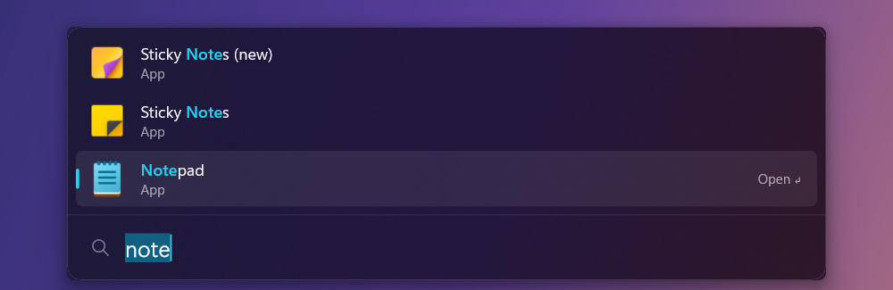

<p align="center">
  
</p>

<h1 align="center">LeanShell</h1>

<p align="center">
  <b>A lean, native Windows 11 shell, taskbar, dock, and Start replacement with ~0% idle resource use.</b><br>
  Forked from <a href="https://github.com/SumirSeth/wisp">SumirSeth/wisp</a> (MIT). See <a href="ROADMAP.md">ROADMAP.md</a> for phases and performance budgets.
</p>

<p align="center">
  <a href="https://github.com/GlitchSlayed/LeanShell/releases/latest"></a>
  <a href="https://github.com/GlitchSlayed/LeanShell/actions/workflows/ci.yml"></a>
  <a href="LICENSE"></a>
  
</p>

<p align="center">
  
</p>

LeanShell is a lightweight, high-performance replacement for the Windows 11 taskbar, Start menu, and shell. It eliminates the heavy overhead of Windows shell experiences while delivering a responsive, keyboard-driven workflow.

---

## Core Goals

1. **Total `explorer.exe` Taskbar & Start Menu Replacement**
   - **Never launch the defaults:** Beyond hiding running taskbars in companion mode, LeanShell's primary goal is exclusive shell replacement (`HKCU\Software\Microsoft\Windows NT\CurrentVersion\Winlogon\Shell`).
   - The default Windows taskbar (`explorer.exe`) and Start Menu (`StartMenuExperienceHost.exe`) never attempt to launch on logon.
   - Explorer is preserved strictly on-demand as a file manager, freeing hundreds of megabytes of idle memory and background threads.
   - Built-in launcher claims the Windows key to replace Start with instantaneous app launching, file search, and system commands.

2. **Both Taskbar Mode & Dock Mode**
   - **Taskbar Mode (AppBar Panel):** A persistent, full-width docked panel (bottom, top, left, or right) that registers as a native Windows AppBar (`ABM_NEW`, `ABM_SETPOS`). Maximized application windows automatically respect the panel's work area without overlap.
   - **Dock Mode:** A floating, auto-hiding dock that slides up when your cursor touches the display edge and recedes when not in use.
   - **Unified Morphing:** In either mode, triggering the hotkey (<kbd>Alt</kbd>+<kbd>Space</kbd> or <kbd>Win</kbd>) smoothly expands the bar/dock directly into the launcher.

3. **Multi-Backend Architecture with Slint Option**
   - **Decoupled Core:** Application models, grammar parsing, app indexing, and state logic live in a pure Rust `core` crate with zero Win32 or UI dependencies.
   - **Direct2D (`ui-d2d` - Default & Reference):** Ultra-lean software renderer prioritizing minimal memory footprint (~20 MB) and true ~0% idle CPU and GPU use.
   - **Slint (`ui-slint` - Optional Feature):** Modern declarative UI backend supporting Skia (default) and Vello (experimental GPU) rendering pipelines for flexible styling and animations.

4. **~0% Idle Resource Footprint**
   - Native Win32 message-driven architecture without runtimes, web views (Electron/CEF), or polling timers. If nothing is happening, LeanShell sleeps.

---

## Features

### Dock

The dock appears when your cursor touches the bottom edge of the display and hides when you move away. Or pin it visible to let maximized windows dock cleanly above it.

| Action | Result |
| --- | --- |
| Click an app | Switch to it |
| Click active app | Minimize it |
| Middle-click an app | Open a new instance |
| Right-click an app | Pin or unpin, or close windows |
| Hover multi-window app | Preview windows (click to switch, middle-click to close) |
| Click a tray icon | Standard notification tray interaction |
| Click **⌄** | Expand hidden system tray icons |
| Right-click **⌄** | Reveal Windows taskbar or open taskbar settings |
| Click volume | Mute or unmute |
| Scroll over volume | Adjust volume smoothly |
| Right-click volume | Open Windows sound settings |
| Click clock | Open Windows notifications and calendar |
| Click battery | Open power & battery settings |
| Scroll on dock | Switch virtual desktops |
| <kbd>Shift</kbd> + scroll | Scroll dock apps |

### Launcher

<p align="center">
  
</p>

Type to search, then press <kbd>Enter</kbd>.

| Type | To |
| --- | --- |
| `code` | Find apps, then files (`vsc` matches Visual Studio Code) |
| `?invoice` | Search indexed files only |
| `^vis` · `term$` · `'note` · `!edge` | Match prefix · suffix · exact phrase · exclude term |
| `sqrt(2) * 10` | Built-in calculator (<kbd>Enter</kbd> copies result) |
| `> ipconfig` | Execute in Command Prompt |
| `wifi off` · `bt` · `vol 40` · `mute` | Toggle settings (<kbd>Tab</kbd> lists available networks/devices) |
| `play` · `pause` · `next` | Control active media playback |
| `w code` | Switch to an active window by title |
| `lock` · `sleep` · `restart` · `shut down` | System power actions |
| `time tokyo` · `date` | Copy current time or date |
| `dark mode` · `display` · … | Open corresponding Windows Settings page |
| `now` · `sound` | Open live system status and audio panels |
| `quit` | Exit LeanShell and restore Explorer taskbar |
| Any search query | Search the web |

#### Drag and Drop

Drag results directly out of the launcher:
- **Files and folders** into chats, emails, or folders.
- **Apps** onto the desktop or Explorer folders to create shortcuts.
- **Text** (calculated values, timestamps, paths) into any text field.
- **Web links** into browsers.

---

## Architecture & Layout

LeanShell is structured into modular crates:

```
core/          app index, search grammar, calculator, config, window/desktop/tray models (no Win32, no UI)
platform-win/  HWND, AppBar, blur, hotkeys and hooks, tray host, shell notifications
render/        Renderer trait and frame description types
ui-d2d/        Direct2D renderer (default, reference software implementation)
ui-slint/      Slint renderer (optional feature backend)
settings/      Settings app (leanshell-settings)
bench/         Benchmarks, baselines, and performance methodology
scripts/       install-nightly, restore-shell, measurement scripts
docs/          VM testing instructions and internal Win32 API documentation
```

---

## Performance Baselines & Budgets

LeanShell enforces strict performance ceilings tracked in [`bench/BASELINE.md`](bench/BASELINE.md):

| Metric | Upstream Wisp 0.2.0 | LeanShell Budget Ceiling |
|---|---|---|
| Idle CPU (hidden dock) | 0.0% | **< 0.05% CPU** |
| Idle CPU (dock visible) | ~0.0% | **< 0.2% CPU** |
| Cold startup time | ~85 ms | **< 150 ms** |
| Hotkey to launcher visible | 15 ms | **< 25 ms** |
| Keystroke to search results | 24 ms | **< 35 ms** |
| Memory (idle, hidden dock) | ~20 MB | **< 25 MB** |
| Memory (peak launcher) | ~35 MB | **< 45 MB** |
| Binary size (`leanshell.exe`) | 1.5 MB | **< 2.5 MB** |

---

## Safety & Recovery

Because LeanShell interacts with shell hooks and hides the system taskbar:
- Shell registration is strictly **per-user** (`HKCU`). LeanShell never touches `HKLM`.
- Any crash or exit automatically triggers taskbar restoration.
- Manual emergency recovery script:
  ```powershell
  powershell -ExecutionPolicy Bypass -File scripts\restore-shell.ps1
  ```
- Shell-level development is verified in an isolated Windows 11 virtual machine. See [`docs/vm-testing.md`](docs/vm-testing.md).

---

## Building

### Requirements
- [Rust](https://rustup.rs) (stable, target `x86_64-pc-windows-msvc`)
- Windows 11 SDK (for MSVC linking)

```sh
git clone https://github.com/GlitchSlayed/LeanShell.git
cd LeanShell
cargo build --release --workspace
```

### Nightly & Isolated Testing
To test local builds without modifying your main installation:
```powershell
powershell -ExecutionPolicy Bypass -File scripts\install-nightly.ps1
```
This builds and runs **LeanShell Nightly** with its own directory, isolated config, and default shortcut (<kbd>Ctrl</kbd>+<kbd>Shift</kbd>+<kbd>Space</kbd>).

---

## Contributing & Agent Guidelines

Contributors and AI coding agents must read and follow [`AGENTS.md`](AGENTS.md) before making changes.

All contributions must pass:
```sh
cargo fmt --all --check
cargo clippy --workspace --all-targets -- -D warnings
cargo test --workspace
```

---

## License & Attribution

- Licensed under the [MIT License](LICENSE).
- Upstream Wisp codebase © 2026 Sumir Seth ([SumirSeth/wisp](https://github.com/SumirSeth/wisp)).
- LeanShell modifications © 2026 LeanShell Contributors.
