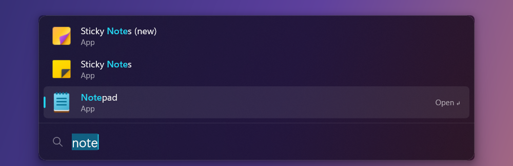

<p align="center">
  
</p>

<h1 align="center">LeanShell</h1>

<p align="center">
  <b>A lean, native Windows 11 shell, taskbar, dock, and Start replacement with ~0% idle resource use.</b><br>
  Forked from <a href="https://github.com/SumirSeth/wisp">SumirSeth/wisp</a> (MIT). See <a href="ROADMAP.md">ROADMAP.md</a> for phases and performance budgets.
</p>

<p align="center">
  <a href="https://github.com/GlitchSlayed/LeanShell/releases/latest"></a>
  <a href="https://github.com/GlitchSlayed/LeanShell/actions/workflows/ci.yml"></a>
  <a href="LICENSE"></a>
  
</p>

<p align="center">
  
</p>

LeanShell is a lightweight, high-performance replacement for the Windows 11 taskbar, Start menu, and shell. It eliminates the heavy overhead of Windows shell experiences while delivering a responsive, keyboard-driven workflow.

---

## Core Goals

1. **Total `explorer.exe` Taskbar, Start & ExperienceHost Takeover**
   - **Never launch the defaults:** LeanShell's primary architecture is exclusive shell replacement (`HKCU\Software\Microsoft\Windows NT\CurrentVersion\Winlogon\Shell`).
   - Background shell bloat (`StartMenuExperienceHost.exe`, `SearchHost.exe`, `Widgets.exe`, `WidgetService.exe`, `ShellExperienceHost.exe`, `CrossDeviceService.exe`) is blocked via reversible IFEO redirection (`neuter_shell_hosts = true`).
   - `explorer.exe` runs strictly on-demand as a file browser (`Win+E`, folder paths) and is automatically reaped once its last folder window and file-operation dialog close (`auto_reap_explorer = true`), freeing hundreds of megabytes of idle RAM and background wakeups.
   - Built-in launcher & hook handle bare <kbd>Win</kbd> plus essential shell chords (<kbd>Win</kbd>+<kbd>E</kbd>, <kbd>Win</kbd>+<kbd>R</kbd>, <kbd>Win</kbd>+<kbd>D</kbd>, <kbd>Win</kbd>+<kbd>I</kbd>, <kbd>Win</kbd>+<kbd>X</kbd>) and native Volume OSD without Explorer.

2. **Both Taskbar Mode & Dock Mode**
   - **Taskbar Mode (AppBar Panel):** A persistent, full-width docked panel (bottom, top, left, or right) that manages monitor work areas (`AppBar` / `SPI_SETWORKAREA`) so maximized windows never overlap it.
   - **Dock Mode:** A floating, auto-hiding dock that slides up when your cursor touches the display edge and recedes when not in use.
   - **Unified Morphing:** In either mode, triggering the hotkey (<kbd>Alt</kbd>+<kbd>Space</kbd> or <kbd>Win</kbd>) smoothly expands the bar/dock directly into the launcher.

3. **100% Native Win32 + Direct2D Architecture**
   - **Decoupled Core & Platform Layer:** Pure models, search grammar, config, host/reaper rules, and hook state machines live in `core`; Win32 shell/IFEO/hook/AppBar integration lives in `platform-win`.
   - **Zero External UI Toolkits (`ui-d2d` & Native D2D Surfaces):** Direct2D + DirectWrite + DWM power every surface across the entire suite—launcher, dock/panel, Volume OSD, `Alt+Tab`/`Win+Tab` switchers, snap overlay, and `leanshell-settings` (~20 MB idle RAM, ~0% idle CPU/GPU).

4. **~0% Idle Resource Footprint**
   - Native Win32 message-driven architecture without runtimes, web views (Electron/CEF), or polling timers. If nothing is happening, LeanShell sleeps.

---

## Features

### Dock

The dock appears when your cursor touches the bottom edge of the display and hides when you move away. Or pin it visible to let maximized windows dock cleanly above it.

| Action | Result |
| --- | --- |
| Click an app | Switch to it |
| Click active app | Minimize it |
| Middle-click an app | Open a new instance |
| Right-click an app | Pin or unpin, or close windows |
| Hover multi-window app | Preview windows (click to switch, middle-click to close) |
| Click a tray icon | Standard notification tray interaction |
| Click **⌄** | Expand hidden system tray icons |
| Right-click **⌄** | Reveal Windows taskbar or open taskbar settings |
| Click volume | Mute or unmute |
| Scroll over volume | Adjust volume smoothly |
| Right-click volume | Open Windows sound settings |
| Click clock | Open Windows notifications and calendar |
| Click battery | Open power & battery settings |
| Scroll on dock | Switch virtual desktops |
| <kbd>Shift</kbd> + scroll | Scroll dock apps |

### Launcher

<p align="center">
  
</p>

Type to search, then press <kbd>Enter</kbd>.

| Type | To |
| --- | --- |
| `code` | Find apps, then files (`vsc` matches Visual Studio Code) |
| `?invoice` | Search indexed files only |
| `^vis` · `term$` · `'note` · `!edge` | Match prefix · suffix · exact phrase · exclude term |
| `sqrt(2) * 10` | Built-in calculator (<kbd>Enter</kbd> copies result) |
| `> ipconfig` | Execute in Command Prompt |
| `wifi off` · `bt` · `vol 40` · `mute` | Toggle settings (<kbd>Tab</kbd> lists available networks/devices) |
| `play` · `pause` · `next` | Control active media playback |
| `w code` | Switch to an active window by title |
| `lock` · `sleep` · `restart` · `shut down` | System power actions |
| `tile` · `snap left` · `task view` | Toggle window tiling, snap active window, or open Task View |
| `time tokyo` · `date` | Copy current time or date |
| `dark mode` · `display` · … | Open corresponding Windows Settings page |
| `now` · `sound` | Open live system status and audio panels |
| `quit` | Exit LeanShell and restore Explorer taskbar |
| Any search query | Search the web |

### Hybrid Window Management

First-class **Mouse + Keyboard** window management without `explorer.exe`:

| Control | Action |
| --- | --- |
| <kbd>Alt</kbd>+<kbd>Tab</kbd> / <kbd>Alt</kbd>+<kbd>Shift</kbd>+<kbd>Tab</kbd> | Direct2D window switcher (click, scroll, or release <kbd>Alt</kbd> to switch; `[×]` or middle-click to close) |
| <kbd>Win</kbd>+<kbd>Tab</kbd> (or Dock / Desktop menu) | Task View with virtual desktop switcher pills, window cards, and clickable **Tiling: On/Off** toggle |
| <kbd>Win</kbd>+<kbd>Left</kbd> / <kbd>Right</kbd> / <kbd>Up</kbd> / <kbd>Down</kbd> | Keyboard snap state machine (halves, quadrants, maximize, restore, minimize) |
| Drag window to edge or corner | Direct2D snap preview overlay with gap-compensated placement |
| <kbd>Win</kbd>+<kbd>T</kbd> (or Task View / menu) | Toggle dynamic Master-Stack tiling per monitor (drag windows to swap slots, drag border to resize split) |

#### Drag and Drop

Drag results directly out of the launcher:
- **Files and folders** into chats, emails, or folders.
- **Apps** onto the desktop or Explorer folders to create shortcuts.
- **Text** (calculated values, timestamps, paths) into any text field.
- **Web links** into browsers.

---

## Architecture & Layout

LeanShell is structured into modular crates:

```
core/          app index, search grammar, calculator, config, window/desktop/tray models (no Win32, no UI)
platform-win/  HWND, AppBar, blur, hotkeys and hooks, tray host, shell notifications
render/        Renderer trait and frame description types
ui-d2d/        Direct2D renderer (sole UI layer across all surfaces)
settings/      Native Win32 + Direct2D settings app (`leanshell-settings`)
bench/         Benchmarks, baselines, and performance methodology
scripts/       install-nightly, restore-shell, measurement scripts
docs/          VM testing instructions and internal Win32 API documentation
```

---

## Performance Baselines & Budgets

LeanShell enforces strict performance ceilings tracked in [`bench/BASELINE.md`](bench/BASELINE.md):

| Metric | Upstream Wisp 0.2.0 | LeanShell Budget Ceiling |
|---|---|---|
| Idle CPU (hidden dock) | 0.0% | **< 0.05% CPU** |
| Idle CPU (dock visible) | ~0.0% | **< 0.2% CPU** |
| Cold startup time | ~85 ms | **< 150 ms** |
| Hotkey to launcher visible | 15 ms | **< 25 ms** |
| Keystroke to search results | 24 ms | **< 35 ms** |
| Memory (idle, hidden dock) | ~20 MB | **< 25 MB** |
| Memory (peak launcher) | ~35 MB | **< 45 MB** |
| Binary size (`leanshell.exe`) | 1.5 MB | **< 2.5 MB** |

---

## Safety & Recovery

Because LeanShell performs deep shell takeover (Winlogon registration, input hooks, IFEO ExperienceHost suppression, and Explorer auto-reaping):
- Every system mutation is **transactionally backed up** (`HKCU\Software\LeanShell\BackupShell`, `HKCU\Software\LeanShell\BackupIFEO`) and cleanly reversed by `--restore-shell` and `scripts\restore-shell.ps1`.
- Holding **Shift** during logon triggers Safe Mode fallback, automatically reverting the Winlogon override and launching `explorer.exe`.
- Any crash or exit automatically triggers restoration via the watchdog supervisor.
- **CLI Flag Escape Hatch**:
  ```powershell
  leanshell.exe --restore-shell
  ```
  (Also available: `--neuter-hosts`, `--restore-hosts`, `--diagnose`)
- **Emergency Key Chord**: Press <kbd>Ctrl</kbd>+<kbd>Alt</kbd>+<kbd>Shift</kbd>+<kbd>Esc</kbd> at any time to immediately restore the taskbar and cleanly exit LeanShell.
- **Manual PowerShell Recovery Script**:
  ```powershell
  powershell -ExecutionPolicy Bypass -File scripts\restore-shell.ps1
  ```
- Shell-level development is verified in an isolated Windows 11 virtual machine. See [`docs/vm-testing.md`](docs/vm-testing.md).

---

## Building

### Requirements
- [Rust](https://rustup.rs) (stable, target `x86_64-pc-windows-msvc`)
- Windows 11 SDK (for MSVC linking)

```sh
git clone https://github.com/GlitchSlayed/LeanShell.git
cd LeanShell
cargo build --release --workspace
```

### Nightly & Isolated Testing
To test local builds without modifying your main installation:
```powershell
powershell -ExecutionPolicy Bypass -File scripts\install-nightly.ps1
```
This builds and runs **LeanShell Nightly** with its own directory, isolated config, and default shortcut (<kbd>Ctrl</kbd>+<kbd>Shift</kbd>+<kbd>Space</kbd>).

---

## Contributing & Agent Guidelines

Contributors and AI coding agents must read and follow [`AGENTS.md`](AGENTS.md) before making changes.

All contributions must pass:
```sh
cargo fmt --all --check
cargo clippy --workspace --all-targets -- -D warnings
cargo test --workspace
```

---

## License & Attribution

- Licensed under the [MIT License](LICENSE).
- Upstream Wisp codebase © 2026 Sumir Seth ([SumirSeth/wisp](https://github.com/SumirSeth/wisp)).
- LeanShell modifications © 2026 LeanShell Contributors.
